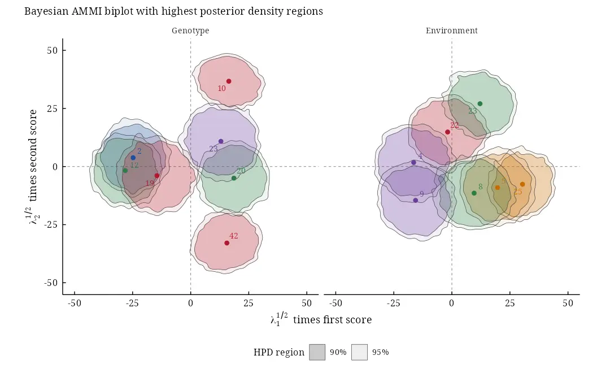

# baystability: Bayesian Stability Analysis of Genotype by Environment Interaction (GEI)

[](https://CRAN.R-project.org/package=baystability)
[](https://cran.r-project.org/web/checks/check_results_baystability.html)
[](https://CRAN.R-project.org/package=baystability)
[](https://CRAN.R-project.org/package=baystability)
[](https://myaseen208.r-universe.dev/baystability)
[](https://github.com/myaseen208/baystability/actions/workflows/R-CMD-check.yml)
[](https://github.com/myaseen208/baystability)
[](https://cran.r-project.org/)
[](https://CRAN.R-project.org/package=baystability)
[](https://www.gnu.org/licenses/old-licenses/gpl-2.0.html)
[](https://www.repostatus.org/#active)
[](https://github.com/myaseen208/baystability/commits)

## Overview

**baystability** fits the linear-bilinear models of multi-environment
trials, AMMI and SREG (GGE), by the general Bayesian method of
Perez-Elizalde, Jarquin and Crossa (2012). The data of an earlier trial
with the same genotypes and environments can be the prior: its cell
means, effects and singular value decomposition give conjugate normal
and von Mises-Fisher priors, weighted by its replicates. Every parameter
has a posterior distribution, and the biplot carries highest posterior
density (HPD) regions.

- [`bayes_ammi()`](https://myaseen208.com/baystability/reference/bayes_ammi.md):
  the Gibbs sampler (compiled), with `.prior_data` (an earlier trial as
  prior), `.model = "AMMI"` or `"SREG"`, the number of terms, chains,
  burn-in and a seed; summaries with HPD intervals, diagnostics, DIC and
  WAIC;
- [`bayes_gge()`](https://myaseen208.com/baystability/reference/bayes_gge.md):
  the SREG (GGE) model, the same as `bayes_ammi(.model = "SREG")`;
- [`bayes_ammi_biplot()`](https://myaseen208.com/baystability/reference/bayes_ammi_biplot.md),
  [`bayes_gge_biplot()`](https://myaseen208.com/baystability/reference/bayes_ammi_biplot.md):
  the biplots with HPD regions;
- [`bys_compare()`](https://myaseen208.com/baystability/reference/bys_compare.md):
  WAIC and DIC of several fits;
  [`bys_interpret()`](https://myaseen208.com/baystability/reference/bys_interpret.md):
  a plain-language interpretation;
  [`bys_cite()`](https://myaseen208.com/baystability/reference/bys_cite.md):
  the references of a result;
- [`bys_ls_means()`](https://myaseen208.com/baystability/reference/bys_ls_means.md),
  [`bys_ls_ge_effects()`](https://myaseen208.com/baystability/reference/bys_ls_ge_effects.md),
  [`bys_ls_ammi()`](https://myaseen208.com/baystability/reference/bys_ls_ammi.md)
  and the other `bys_ls_` functions: the tables and the least-squares
  AMMI (the names of version 0.2.0 still work, with a deprecation
  warning);
- [`bys_app()`](https://myaseen208.com/baystability/reference/bys_app.md):
  all of this in a web browser, without code.

Version 1.0.0 replaces the sampler of version 0.2.0. That version read
the earlier trial from objects in the workspace, never sampled the
singular values and returned a precision computed from a residual that
was never updated (see NEWS). The new sampler reproduces the 38 linear
effects of Table B.1 of the paper to within 0.03 posterior standard
deviations. It adds exact two-column moves, without which the genotype
scores of a fit with all terms cannot move.

For Bayesian stability analysis in general (Finlay-Wilkinson,
Eberhart-Russell and Shukla models, stability indices, probabilities of
superior performance), see **bayesstability**. For the Bayesian AMMI
model of Crossa et al. (2011), see **bayesammi**.

## Installation

``` r

install.packages("baystability")
```

## Quick start

``` r

library(baystability)
data(cultivo2008)
data(cultivo2009)
fm <-
  bayes_ammi(
      .data       = cultivo2009
    , .y          = y
    , .gen        = entry
    , .env        = site
    , .rep        = rep
    , .nIter      = 3000
    , .prior_data = cultivo2008
    , .n0         = NULL
    , .model      = "AMMI"
    , .k          = NULL
    , .burnin     = 1000
    , .thin       = 1
    , .chains     = 2
    , .priors     = bys_priors(
          mu_mean     = 0
        , mu_var      = 1e+8
        , tau_mean    = 0
        , tau_var     = 1e+8
        , delta_mean  = 0
        , delta_var   = 1e+8
        , lambda_mean = 0
        , lambda_var  = 1e+8
        , nu          = 1
        , s2          = NULL
        )
    , .level      = 0.95
    , .seed       = 2012
    , .align      = TRUE
    , .waic       = TRUE
    )
fm$summary[block %in% c("mu", "sigma2", "lambda")][1:5]
```

``` R
   parameter  block label axis        mean           sd        mc_se
1:        mu     mu         NA    3848.226     30.84317    0.3981837
2:    sigma2 sigma2         NA 1705532.341 102595.88335 1441.5652227
3: lambda[1] lambda          1    3661.031    396.46664    9.1043484
4: lambda[2] lambda          2    3281.938    351.22780    8.8038961
5: lambda[3] lambda          3    2824.031    315.66069    8.8833684
         lower       upper      ess     rhat
1:    3787.723    3909.102 6000.000 1.000438
2: 1500321.098 1902118.289 5065.138 1.000096
3:    2889.820    4423.813 1896.337 1.003106
4:    2591.935    3960.180 1591.578 1.004796
5:    2213.368    3459.256 1262.658 1.003067
```

``` r

bp <-
  bayes_ammi_biplot(
      fit           = fm
    , burnin        = 0
    , thin          = 1
    , pb            = c(0.10, 0.05)
    , plot_stable   = FALSE
    , plot_unstable = TRUE
    , ncolors       = 5
    , .which        = "both"
    , .grid         = 100
    )
bp$biplot
```



## Learn more

- Vignettes: `browseVignettes("baystability")`, starting with
  `baystability_01_getting_started`.
- The application:
  [`bys_app()`](https://myaseen208.com/baystability/reference/bys_app.md).
- References of the methods behind a result:
  [`bys_cite()`](https://myaseen208.com/baystability/reference/bys_cite.md)

## Citation

``` R
Yaseen M, Jarquin D, Perez-Elizalde S, Burgueno J, Crossa J (2026).
_baystability: Bayesian Stability Analysis of Genotype by Environment
Interaction (GEI)_. R package version 1.0.0 (first released 2018),
<https://CRAN.R-project.org/package=baystability>.
```

BibTeX:

``` R
@Manual{baystability,
  title = {{baystability}: Bayesian Stability Analysis of Genotype by Environment Interaction ({GEI})},
  author = {Muhammad Yaseen and Diego Jarquin and Sergio Perez-Elizalde and Juan Burgueno and Jose Crossa},
  year = {2026},
  note = {R package version 1.0.0 (first released 2018)},
  url = {https://CRAN.R-project.org/package=baystability},
}
```

Please also cite the methods you use: `citation("baystability")` lists
them with the package, and `bys_cite(x)` gives the references of a
single result.
